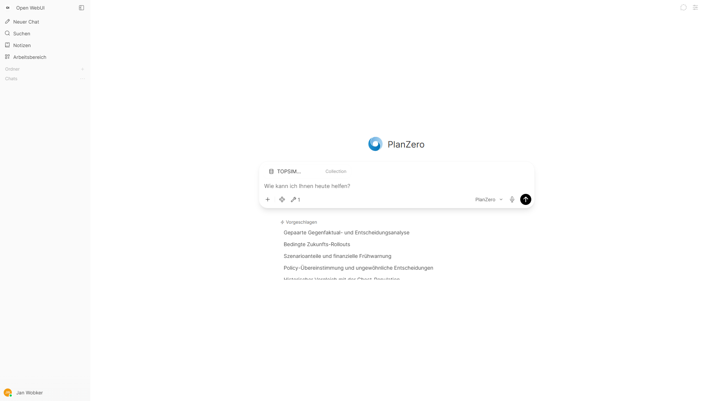
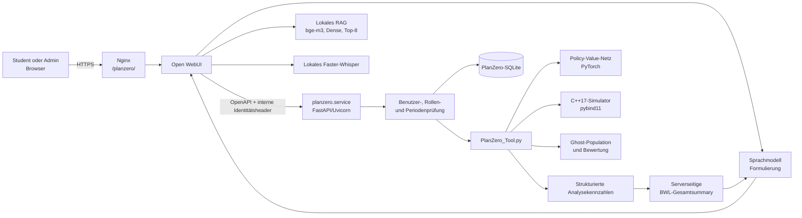
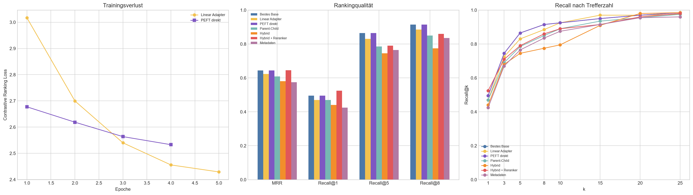
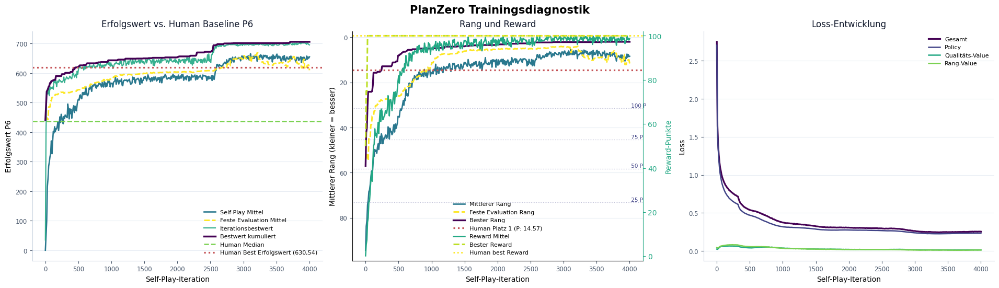
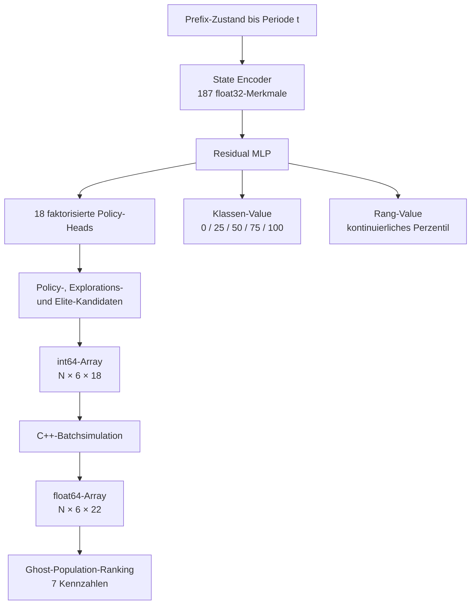
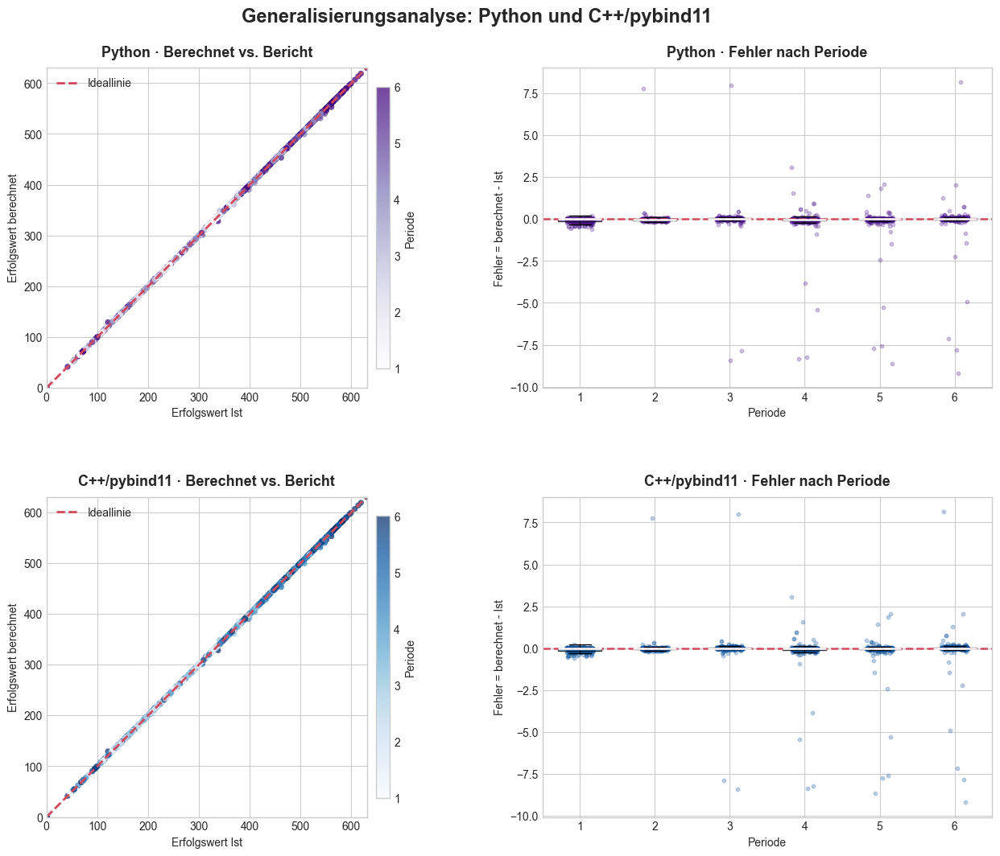
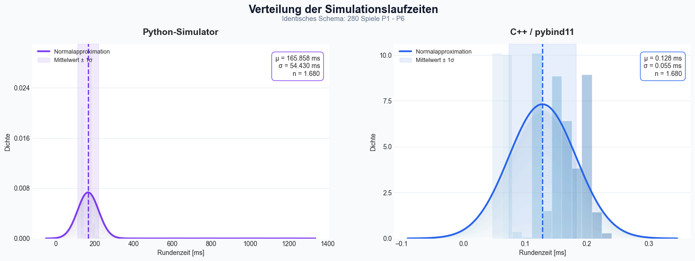

# PlanZero

**Model-based Reinforcement Learning und rollengeschützte Betriebswirtschaftliche-Analysen für ein
sechsperiodiges Unternehmensplanspiel**

> **Forschungsfrage:** Wie lässt sich eine rekonstruierte, deterministische
> Unternehmenssimulation mit AlphaZero-artiger Policy-Value-Planung und
> erklärbarer KI verbinden, ohne die Eigenständigkeit studentischer
> Entscheidungen aufzuheben?


PlanZero verbindet ein explizites, reportfreies Weltmodell mit einem trainierten
Policy-Value-Netz, einem nativen C++17-Simulator und einer produktiven
OpenAPI-Schnittstelle. Der Dienst rekonstruiert die freigegebene Vergangenheit,
simuliert bedingte Fortsetzungen, lokale Sensitivitäten und gepaarte
Gegenfakten und formuliert daraus serverseitig eine verständliche
BWL-Gesamtanalyse.



Die studentische Oberfläche läuft in Open WebUI. Identität, Rolle, Spielnummer,
Unternehmen und aktive Periode werden außerhalb des Sprachmodells bestimmt.
Normale Nutzer erhalten keine konkreten zukünftigen Entscheidungswerte; diese
sind ausschließlich über eine gesondert freigegebene Adminfrage verfügbar.

Zum Gesamtprojekt gehört außerdem ein separates RAG-Evaluations-Repository. Es
liefert die empirische Grundlage für das lokale Dokumentenretrieval in Open
WebUI. Dieses RAG ergänzt allgemeine Fachfragen um passende Textpassagen, ist
aber keine Quelle für benutzerbezogene Spielstände oder PlanZero-Berechnungen.

## Projektstatus

| Komponente | Stand |
|---|---|
| Rekonstruktion der Planspiellogik | implementiert und historisch validiert |
| Paralleler C++17-Simulator über `pybind11` | implementiert und produktiv auf ARM64 gebaut |
| Faktorisiertes Policy-Netz mit zwei Value-Heads | trainiert; Endcheckpoint produktiv geladen |
| Bedingte Rollouts, Sensitivitäten und Gegenfakten | implementiert |
| SQLite-Daten- und Periodenfreigabe | implementiert |
| FastAPI-/OpenAPI-Microservice | produktiv integriert |
| Open-WebUI-Toolserver mit Rollenprüfung | produktiv integriert |
| Open-WebUI-RAG-Retrieval | evaluiert; `BAAI/bge-m3`, Dense Retrieval und Top-8 ausgewählt |
| Serverseitige, nicht präskriptive BWL-Summary | implementiert |
| Datensparsame Langfuse-Instrumentierung | implementiert, fail-open |
| Automatischer Crawler | Datenvertrag definiert, noch separat umzusetzen |
| Unabhängiger Superhuman-Arena-Nachweis | noch ausstehend |

Die Simulation selbst verwendet **kein Machine Learning**. Markt, Produktion,
Kosten, Liquidität, Bilanz und Erfolgswert entstehen aus rekonstruierten
Wirkungskurven, festen Szenarioregeln und chronologischen Zustandsübergängen.
Deep Learning kommt bei Policy, Value-Schätzung und der Erzeugung von
U1-Strategiefortsetzungen zum Einsatz.

## Gesamtarchitektur



Open WebUI, das Sprachmodell und PlanZero haben getrennte Aufgaben:

- Open WebUI authentifiziert Nutzer, verwaltet Chats und setzt beim Toolaufruf
  die internen Identitätsheader.
- Das lokale RAG stellt für allgemeine Fachfragen empirisch ausgewählte
  Dokumentpassagen bereit. Es hat keinen Zugriff auf die PlanZero-SQLite-Daten
  und ersetzt keine Toolanalyse.
- Das Sprachmodell erkennt die Fragekategorie, ruft PlanZero auf und gibt die
  bereits fertige Summary verständlich wieder.
- `planzero_api.py` erzwingt Identität, Rolle, Serverperiode und Datenfreigabe.
- `PlanZero_Tool.py` führt Inferenz und sämtliche numerischen Analysen aus.
- `simulation.cpp` berechnet die deterministischen Zustandsübergänge.
- `planzero_api.py` rendert aus den strukturierten Ergebnissen die
  rollengeschützte BWL-Gesamtanalyse. Ein großer Rohkontext wird nicht an das
  Sprachmodell ausgeliefert.

Der Microservice verwendet genau einen Uvicorn-Worker. Weil der native
Simulator prozessglobalen Zustand besitzt, serialisiert `_NATIVE_LOCK`
vollständige Analysen; innerhalb einer Analyse darf der native Batch weiterhin
mehrere Worker verwenden.

## RAG-Retrieval-Evaluation als separates Teilprojekt

Das eigenständige RAG-Eval-Repository untersucht, welche
Retrieval-Konfiguration geeignete Textabschnitte zuverlässig für Open WebUI
bereitstellt. Die Evaluation trennt damit zwei fachlich verschiedene
Wissenspfade:

- **RAG:** statische Dokumente und allgemeines Fachwissen als ergänzender
  Kontext für normale Chats.
- **PlanZero-Tool:** serverseitig berechnete Quelle für
  benutzer-, spiel- und periodenbezogene Analysen.

RAG-Treffer dürfen weder Benutzeridentität und Rollenrechte noch Spielnummer,
aktive Periode, SQL-Cutoff oder numerische PlanZero-Ergebnisse überschreiben.
Bei einer PlanZero-Frage bleibt die rollengeschützte Tool-Summary maßgeblich.

### Versuchsaufbau

Der untersuchte Dokumentbestand wurde in 48 inhaltlich geschlossene Chunks
zerlegt. Überschriften strukturieren die Quelle, werden aber nicht Bestandteil
der Textchunks. Für jeden Chunk wurden manuell 20 unterschiedliche Nutzerfragen
formuliert. Die Aufteilung erfolgte gruppiert nach Zielchunks:

| Split | Chunks | Fragen |
|---|---|---:|
| Training | 30 | 600 |
| Validation | 8 | 160 |
| Test | 10 | 200 |

Fragen desselben Chunks gelangen dadurch nicht gleichzeitig in Training und
finale Test. Externe Paper-Chunks dienen ausschließlich als
Trainingsnegative; sie werden weder durchsucht noch evaluiert.

Verglichen wurden drei Embedding-Modelle sowie Dense Retrieval, ein linearer
Adapter, partielles direktes Fine-Tuning, Parent-Child Retrieval, hybride
BM25-Suche, Cross-Encoder-Reranking und Metadaten-Retrieval. Die Bewertung
verwendet:

### Mean Reciprocal Rank

$\displaystyle \mathrm{MRR}=\frac{1}{|Q|}\sum_{i=1}^{|Q|}\frac{1}{r_i}$

Die MRR gewichtet frühe Treffer besonders stark. Der Wertebereich liegt zwischen 0 und 1; ein höherer Wert ist besser. Eine MRR von 1 bedeutet, dass der korrekte Chunk bei jeder Frage an erster Stelle steht. Die MRR ist nicht selbst die mittlere Listenposition, sondern der Mittelwert ihrer Kehrwerte.

### Mean Rank

$\displaystyle \mathrm{MeanRank}=\frac{1}{|Q|}\sum_{i=1}^{|Q|}r_i$

Der Mean Rank gibt die durchschnittliche Position des korrekten Chunks in der Ergebnisliste an. Hier ist ein kleinerer Wert besser; der optimale Wert ist 1.

### Recall@k

$\displaystyle \mathrm{Recall@}k=\frac{1}{|Q|}\sum_{i=1}^{|Q|}\mathbb{1}(r_i\leq k)$

Die Indikatorfunktion $\mathbb{1}(r_i\leq k)$ nimmt den Wert 1 an, wenn der korrekte Chunk unter den ersten $k$ Treffern liegt, andernfalls 0. Da jede Frage genau einem Zielchunk zugeordnet ist, entspricht Recall@k hier dem Anteil der Fragen, für die dieser Zielchunk in den Top-k gefunden wird. Ein höherer Wert ist besser.

### Ergebnisse



| Verfahren | MRR | Mean Rank | Recall@1 | Recall@5 | Recall@8 |
|---|---:|---:|---:|---:|---:|
| Bestes Base-Modell | 0,6444 | 3,555 | 0,495 | 0,865 | 0,915 |
| Linear Adapter | 0,6239 | 3,740 | 0,470 | 0,830 | 0,885 |
| Direktes partielles Fine-Tuning | 0,6444 | 3,555 | 0,495 | 0,865 | 0,915 |
| Parent-Child | 0,6086 | 4,435 | 0,470 | 0,785 | 0,850 |
| Hybrid | 0,5809 | 5,140 | 0,440 | 0,745 | 0,775 |
| Hybrid + Reranker | **0,6453** | 4,660 | **0,525** | 0,790 | 0,860 |
| Metadaten-Retrieval | 0,5749 | 4,900 | 0,425 | 0,765 | 0,835 |

`BAAI/bge-m3` erzielte im Modellvergleich die besten Tuning-Ergebnisse. Das
unveränderte Base-Modell erreicht auf der strikt getrenntem Test einen
Recall@5 von 86,5 % und einen Recall@8 von 91,5 %. Die zusätzlichen drei
Treffer erhöhen die Abdeckung damit um 5,0 Prozentpunkte; deshalb verwendet der
Betrieb bewusst `k = 8`.

Adapter und partielles Fine-Tuning liefern keinen belastbaren
Validierungsvorteil. Dies ist im Hinlbick auf die mit 600 Fragen geringe Trainingsmenge nicht verwunderlich.
Hybrid + Reranker verbessert die MRR lediglich von 0,6444
auf 0,6453 und den Recall@1 von 49,5 % auf 52,5 %, senkt aber Recall@5 und
Recall@8. Gleichzeitig steigt die lokal gemessene CPU-Latenz pro Frage von
30,6 ms auf 1161,8 ms. Modellladezeit und Indexaufbau sind in diesen Werten
nicht enthalten. Der geringe Gewinn rechtfertigt daher weder die zusätzliche
Latenz noch die höhere Komplexität.

## Datenfluss einer Analyse

1. Open WebUI authentifiziert den Nutzer und übermittelt User-ID, Name,
   E-Mail-Adresse und Rolle in vier für das Modell unsichtbaren Headern.
2. `planzero_api.py` prüft Rolle und Frageberechtigung. Fehlender Kontext führt
   zu `401`, eine gesperrte Frage zu `403` und ein fehlendes Mapping zu `404`.
3. `user_game_mapping` ordnet den Nutzer serverseitig einer sechsstelligen
   Spielnummer und `Unternehmen_1` zu.
4. `settings.py` bestimmt anhand der Serverzeit in `Europe/Berlin` die aktive
   Periode N und deren Abgabefrist. Eine abweichend angeforderte Periode wird
   mit `422` abgelehnt.
5. `SQLDecisionStore` lädt für U1 nur abgeschlossene Perioden bis P(N−1),
   ergänzt den offiziellen P0-Zustand und verbindet sie mit dem vollständigen,
   versionierten U2–U6-Gegnerszenario für P1–P6.
6. Das Policy-Netz leitet die aktuelle U1-Entscheidung aus der freigegebenen
   Historie ab. Ein ausdrücklich angegebener Override verändert nur diese
   aktuelle Modellentscheidung und keine SQL-Daten.
7. Der native Simulator berechnet Vergangenheit, Referenzverlauf, bedingte
   Zukunfts-Rollouts, lokale Sensitivitäten und gepaarte Gegenfakten.
8. Die API erzeugt daraus eine vollständige Summary mit Zeitkontext,
   Datenabgrenzung, Kennzahlen, Unsicherheiten und Warnhinweisen.

Die Beschreibung des OpenAPI-Tools weist das Sprachmodell an, PlanZero pro
zusammenhängendem Analysezustand **genau einmal** aufzurufen. Folgefragen werden
aus der bereits im Chat vorhandenen Gesamtsummary beantwortet. Das ist eine
Modellinstruktion, kein serverseitiger Chat-Lock: Ein technisch erneut
gesendeter gültiger Request würde erneut berechnet.

## Beispiel: Nutzeranfrage in der aktiven Periode 3

Bei einer Anfrage in P3 lädt PlanZero für U1 ausschließlich die abgeschlossenen
Entscheidungen aus P1 und P2. Die aktuelle P3-Entscheidung wird nicht aus SQL
gelesen, sondern aus der Policy abgeleitet; ein ausdrücklich angegebener
Nutzer-Override würde nur diese P3-Entscheidung verändern. Sie bleibt in allen
bedingten Fortsetzungen fixiert. Erst die U1-Entscheidungen für P4 bis P6
variieren zwischen den standardmäßig 128 Rollouts. Alle historischen und
simulierten Verläufe treten dabei gegen dieselben festen U2–U6-Entscheidungen
des Szenarios `standardgegner_v1` an.

```mermaid
flowchart LR
    Q([Nutzeranfrage in P3]) --> API[API prüft Identität, Rolle und Frage<br/>ordnet Spielnummer zu und bestätigt Serverperiode 3]

    subgraph T[Freigegebener Zustand und aktuelle Entscheidung]
        direction LR
        P0[P0<br/>offizieller gemeinsamer<br/>Ausgangszustand]
        P1[P1 abgeschlossen<br/>U1-Entscheidung aus SQL]
        P2[P2 abgeschlossen<br/>U1-Entscheidung aus SQL]
        INF[Policy- und<br/>Value-Inferenz]
        P3[P3 aktuell<br/>Policy-Modus oder<br/>ausdrücklicher Override<br/>keine P3-SQL-Zeile]
        P0 --> P1 --> P2 --> INF --> P3
    end

    API --> P0
    OPP[Feste Gegner U2–U6<br/>P1 bis P6<br/>standardgegner_v1]
    P2 --> PAST[C++-Rekonstruktion<br/>der Vergangenheit P1–P2]
    OPP -. unverändert .-> PAST

    P3 --> BATCH[C++-Batch<br/>128 bedingte U1-Rollouts<br/>P3 in allen Verläufen fixiert]
    OPP -. in jedem Verlauf unverändert .-> BATCH

    subgraph R[Repräsentative Simulationsverläufe — insgesamt 128]
        direction LR
        A4[P4 · Verlauf 1] --> A5[P5 · Verlauf 1] --> A6[P6 · Verlauf 1]
        B4[P4 · Verlauf 2] --> B5[P5 · Verlauf 2] --> B6[P6 · Verlauf 2]
        X4[P4 · Verläufe 3–127] --> X5[P5 · Verläufe 3–127] --> X6[P6 · Verläufe 3–127]
        Z4[P4 · Verlauf 128] --> Z5[P5 · Verlauf 128] --> Z6[P6 · Verlauf 128]
    end

    BATCH --> A4
    BATCH --> B4
    BATCH --> X4
    BATCH --> Z4

    A6 --> AGG[Aggregation aller P3–P6-Verläufe<br/>Mediane, Bandbreiten, Szenarioanteile<br/>und finanzielle Warnindikatoren]
    B6 --> AGG
    X6 --> AGG
    Z6 --> AGG

    PAST --> EXTRA[Zusatzanalysen<br/>Vergangenheit, Policy-Abweichungen,<br/>lokale Sensitivitäten und Gegenfakten]
    P3 --> EXTRA
    AGG --> GHOST[Ghost-Vergleich und<br/>Bewertung bis P6]
    EXTRA --> SUM[Serverseitige BWL-Gesamtsummary<br/>alle Bereiche 1–7 gemeinsam]
    AGG --> SUM
    GHOST --> SUM
    SUM --> OW[Open WebUI gibt die Summary wieder<br/>Adminfrage ergänzt konkrete Entscheidungswerte]

    classDef history fill:#dbeafe,stroke:#2563eb,color:#111827;
    classDef current fill:#fef3c7,stroke:#d97706,color:#111827;
    classDef future fill:#dcfce7,stroke:#16a34a,color:#111827;
    classDef fixed fill:#f3e8ff,stroke:#9333ea,color:#111827,stroke-dasharray:5 5;
    classDef result fill:#f3f4f6,stroke:#4b5563,color:#111827;
    class P0,P1,P2,PAST history;
    class INF,P3,BATCH current;
    class A4,A5,A6,B4,B5,B6,X4,X5,X6,Z4,Z5,Z6 future;
    class OPP fixed;
    class API,AGG,EXTRA,GHOST,SUM,OW result;
```



Die vier gezeichneten Äste stehen exemplarisch für das gesamte Ensemble; der
mittlere Ast fasst die Verläufe 3 bis 127 nur zur besseren Lesbarkeit zusammen.
PlanZero bewertet nicht bloß einen vermeintlich „besten“ Pfad: Die Summary
trennt den einzelnen Referenzverlauf von den Medianen und Bandbreiten aller 128
Fortsetzungen. Zusätzlich werden aktuelle P3-Alternativen lokal und gepaart
unter kontrollierten Zukunftsbedingungen geprüft, bevor die sieben
nicht präskriptiven Analysebereiche zusammengeführt werden.

## Datenmodell und Schutz vor Zukunftsdaten

Die produktive SQLite-Datenbank enthält vier fachliche Tabellen:

| Tabelle | Aufgabe |
|---|---|
| `user_game_mapping` | Zuordnung von Open-WebUI-Nutzern zu Spielnummer und Unternehmen |
| `period_decisions` | individuelle, validierte U1-Entscheidungen mit 20 kanonischen Feldern |
| `opponent_scenarios` | Metadaten und Aktivstatus versionierter Gegnerszenarien |
| `opponent_scenario_decisions` | vollständige U2–U6-Entscheidungen eines Szenarios |

Die kanonische Spielnummer besteht aus genau sechs ASCII-Ziffern. Das aktive
Szenario `standardgegner_v1` umfasst exakt `6 Perioden × 5 Gegner = 30` Zeilen.
Bei aktiver Periode N dürfen aus `period_decisions` nur U1-Zeilen bis P(N−1)
einfließen:

| Aktive Periode | Freigegebene individuelle U1-Historie |
|---:|---|
| P1 | keine U1-Zeile |
| P2 | P1 |
| P3 | P1–P2 |
| P4 | P1–P3 |
| P5 | P1–P4 |
| P6 | P1–P5 |

Bereits gespeicherte aktuelle oder zukünftige U1-Zeilen bleiben durch den
SQL-Cutoff ausgeschlossen. Der Store erzeugt intern die vom Simulator
erwarteten 42 Zeilen aus:

- sechs offiziellen P0-Zeilen,
- 30 festen U2–U6-Zeilen für P1–P6,
- den freigegebenen U1-Zeilen bis P(N−1),
- deutlich markierten technischen U1-Platzhaltern von P(N) bis P6.

Die Platzhalter sind keine historische Evidenz. Die aktuelle U1-Entscheidung
kommt aus dem Policy-Modus, spätere U1-Entscheidungen entstehen ausschließlich
in den Modell-Rollouts. Der native Cache berücksichtigt neben der Spielnummer
eine Signatur der freigegebenen Konfigurationsdaten und wird bei neuen
Crawlerdaten oder einem Periodenwechsel zuverlässig invalidiert.

## Analyseumfang und Rollenmodell

Das Tool kennt acht Fragekategorien, welche als vorgeschlagene Prompts in OpenWebUI hinterlegt sind:

1. Vergangenheitsanalyse
2. Bedingte Zukunfts-Rollouts
3. Lokale Sensitivitätsanalyse
4. Gepaarte Gegenfaktual- und Entscheidungsanalyse
5. Historischer Vergleich mit der Ghost-Population
6. Policy-Übereinstimmung und ungewöhnliche Entscheidungen
7. Szenarioanteile und finanzielle Frühwarnung
8. Konkrete beste nächste Entscheidungen

Eine Frage aus 1 bis 7 dient als Auslöser und Berechtigungsschlüssel, reduziert
aber nicht die Berechnung. Normale Nutzer erhalten immer die gemeinsame,
nicht präskriptive Summary aller sieben Bereiche. Nur die für Admins
freigegebene Frage 8 setzt serverseitig `include_action_values=True` und ergänzt
konkrete aktuelle und spätere Werte. Dieser Schalter ist kein Toolparameter und
kann nicht durch Promptinjection aktiviert werden.

Standardmäßig berechnet PlanZero in P1 bis P5 128 bedingte Fortsetzungen. In P6
gibt es keine spätere U1-Entscheidungsperiode mehr; die Fortsetzung ist daher
deterministisch und besteht aus einem Szenario. Der Forecast-Median über viele
Rollouts und der einzelne Referenzverlauf sind bewusst getrennte Größen.

Das öffentliche Request-Schema enthält nur:

```text
frage, periode, entscheidung, simulationen, temperatur, seed
```

Im Normalfall wird ausschließlich `frage` gesetzt. Die anderen Felder sind
optionale Bestätigungen oder technische Overrides. Identität, Rolle,
Spielnummer, Unternehmen und `include_action_values` sind im Body weder sichtbar
noch setzbar.

Die API-Antwort ist bewusst klein:

```text
question
question_title
spielnummer
periode
period_status
summary
validation_warnings
```

Ein `context`-Feld oder das vollständige interne Analyse-JSON werden nicht an
das Sprachmodell zurückgegeben.

## Periodensteuerung

Die sechs Fenster sind zeitzonenbewusst und halboffen
(`start <= Zeitpunkt < end`). An einem gemeinsamen Grenztag wechselt die
Periode exakt um 10:00 Uhr in `Europe/Berlin`.


| Periode | Beginn | Ende / Abgabefrist |
|---:|---|---|
| P1 | 14.08.2026, 10:00 | 26.10.2026, 10:00 |
| P2 | 26.10.2026, 10:00 | 09.11.2026, 10:00 |
| P3 | 09.11.2026, 10:00 | 23.11.2026, 10:00 |
| P4 | 23.11.2026, 10:00 | 07.12.2026, 10:00 |
| P5 | 07.12.2026, 10:00 | 21.12.2026, 10:00 |
| P6 | 21.12.2026, 10:00 | 04.01.2027, 10:00 |

Außerhalb dieser Fenster lehnt der Dienst Analysen mit `422` ab. Jede Summary
beginnt mit dem einmal pro Request ermittelten Serverdatum, der Uhrzeit, der
aktiven Periode und ihrer Abgabefrist.

## Ergebnis des abgeschlossenen Trainingslaufs



Der Lauf vom 29. Juli 2026 wurde auf einem Intel Core i7-14600KF mit vier nativen
Workern und einer NVIDIA GeForce RTX 4070 Ti vollständig abgeschlossen.

| Kennzahl | Ergebnis |
|---|---:|
| Trainingsdauer | 901,9 Minuten (ca. 15 Stunden 2 Minuten) |
| Self-Play-Iterationen | 4.000 |
| Self-Play-Partien | 512.000 (128 je Iteration) |
| Kandidaten je Zustand | 64 |
| vollständige P1–P6-Simulationen im Self-Play | 196.608.000 |
| vollständige P1–P6-Simulationen einschließlich fester Evaluation | 204.521.472 |

Das Modell lernte zunächst schnell, verbesserte sich nach einer längeren
Plateauphase ab etwa Iteration 2.600 erneut und erreichte seine stärkste feste
Evaluation in Iteration 3.200: einen mittleren Erfolgswert von **668,62** und
einen mittleren Rang von **4,01**. Die Ghost Population umfasst 107 vollständig
bewertete Spielergebnisse von Studierenden aus dem Sommersemester 2026. Die
historischen Vergleichsmarken liegen bei einem Erfolgswert von 630,54 und einem
Rang von 14,57 (kleiner ist besser). Der beste einzelne Plan des Laufs erreichte
706,07; der höchste Self-Play-Mittelwert lag bei 665,78.

Gegen Ende blieb das Self-Play mit 655,05 Punkten stark, während die feste
Evaluation auf 609,74 Punkte beziehungsweise Rang 11,62 zurückging. Der Loss
fiel dennoch von 2,7483 auf 0,2546. Das spricht für eine späte Spezialisierung
auf die Trainingssuche und gegen die Annahme, dass der niedrigste Loss
automatisch den besten generalisierenden Checkpoint liefert. Die feste
Evaluation verwendete wiederholt denselben Seed und nur 128 Partien. Ein formaler Superhuman-Nachweis
auf unabhängigen Seeds steht noch aus.

## Policy-Value- und Simulationsarchitektur

PlanZero übernimmt von AlphaZero die Kombination aus explizitem Weltmodell,
Policy-Prior und langfristiger Value-Schätzung. Es ist jedoch weder ein
unverändertes Zwei-Spieler-Nullsummenverfahren noch klassische PUCT-MCTS. Das
Planspiel ist ein deterministisches, mehrperiodiges Planungsproblem mit einem
breiten, faktorisierten Management-Aktionsraum.



Der Encoder bildet den chronologischen U1-Entscheidungs- und Ergebnisverlauf
auf 187 Merkmale ab. Das Netz besitzt 18 periodenabhängig maskierte
Policy-Heads sowie zwei Value-Heads:

- Der Klassen-Value lernt die diskrete Rewardklasse `0/25/50/75/100`.
- Der Rang-Value lernt das kontinuierliche Rangperzentil gegenüber der festen
  Ghost Population.

Die Suche verbessert lokale Kandidaten in großen Batches. Vollständige
Fortsetzungen werden als dichte Arrays an den C++-Simulator übergeben; Excel
oder Ergebnisreports werden dabei nicht gelesen. Das vermeidet eine
Python-basierte Baumexpansion über den kartesischen Produktraum aller
Entscheidungsdimensionen.

Der Simulator verarbeitet unter anderem Preis, Werbung, Vertrieb, Qualität,
Produktion, Einsatzstoffe, Personal, Investitionen, Finanzierung, Lager,
Liquidität und Bilanz. Ein Lauf umfasst chronologisch Marktreaktionen,
Lieferfähigkeit, Nachfrageumverteilung, Produktion, Kostenrechnung, Liquidität,
Bilanz, Periodenergebnis und Erfolgswert.

## Ghost Population und Reward

Die offizielle Bewertungsmatrix wird beim
Erzeugen der Reward-Klasse dabei einmalig eingelesen.

Die feste Ghost Population bewertet Pläne über sieben Kennzahlen:

1. kumulierter Periodenüberschuss,
2. Erfolgswert,
3. Eigenkapitalquote,
4. Umsatz,
5. Kassenendbestand,
6. Abweichung der Mitarbeiterauslastung,
7. Abweichung der Anlagenauslastung.

Die historischen Quintilsgrenzen erzeugen die diskreten Klassen
`100 | 75 | 50 | 25 | 0`. Der zusätzliche Rang-Value liefert innerhalb einer
Klasse ein kontinuierliches Lernsignal, ohne die primäre Bewertungslogik zu
verändern.

## Simulatorvalidierung

Die Python- und C++-Implementierungen wurden chronologisch über alle 108
historischen Spiele geprüft. Die C++-Portierung reproduziert die reportfreie
Python-Logik nahezu numerisch:

| Größe | MaxAbs C++ gegenüber Python |
|---|---:|
| Erfolgswert | 0,0110 |
| Periodenüberschuss | 0,0356 T€ |
| Umsatz | < 2 × 10⁻¹² T€ |
| potenzieller Absatz Online | 0 |
| potenzieller Absatz Einzelhandel | 0 |
| tatsächlicher Absatz | < 8 × 10⁻¹² Stück |

Die historische Ende-zu-Ende-Validierung liest den tatsächlichen Erfolgswert
erst nach Abschluss der eigenen Berechnung. Markt-, Kosten- oder
Erfolgswertreports sind keine Simulationsinputs.





## Didaktische und methodische Leitplanken

- **Keine Zukunftsdaten-Leakage:** Die serverseitige Periode begrenzt die
  freigegebene U1-Historie strikt auf P(N−1).
- **Keine historischen Zielwerte als Modellinput:** Historische Ergebniswerte
  dienen der festen Ghost-Population, nicht den Simulationsübergängen.
- **Keine Report-Zwischenwerte:** Marktvolumen, Absatz, Umsatz, Kosten und Bilanz
  entstehen im Weltmodell.
- **Keine ML-Näherung im Simulator:** Das Weltmodell besteht aus expliziten
  Regeln und Wirkungskurven.
- **Chronologische Zustände:** Lager, Bekanntheit, Personal, Maschinen,
  Liquidität und Eigenkapital werden periodisch fortgeschrieben.
- **Getrennte Rollen:** Studierende erhalten Analyse und Zielkonflikte, aber
  keine konkreten nächsten Entscheidungswerte.
- **Vorsicht:** Gegenfakten sind innerhalb des rekonstruierten
  Weltmodells kausal kontrolliert, aber kein Kausalitätsbeweis außerhalb des
  Planspiels. Insolvenzindikatoren sind einfach Planspiel-Proxys.

## Sicherheit und Observability

Die Identitäts- und Rollenprüfung liegt serverseitig. Das Sprachmodell kann
weder Rolle noch Spielnummer, Unternehmen oder Adminwerte als Bodyparameter
setzen. SQL-Zugriffe sind parametrisiert und die 20 Entscheidungsfelder werden
gegen eine feste kanonische Liste validiert.

Dienste sind durch die Firewall geschützt und nur im Subnetz erreichbar.

Langfuse zeichnet zwei getrennte Ebenen auf: den Open-WebUI-Chatturn und die
direkte PlanZero-Analyse. Tiefenspans erfassen nur kuratierte technische
Metadaten; vollständige Entscheidungen, Modelllogits, NumPy-Batches,
E-Mail-Adressen und Summary-Volltexte werden nicht automatisch gespeichert.
Die Spielnummer erscheint nur als SHA-256-Kurzverweis. Observability arbeitet
fail-open und darf die fachliche Analyse nicht blockieren.

## Projektstruktur

```text
.
├── rl_alpha_zero_outputs/
│   └── planzero_policy_value.pt
└── simulation_c++/
    ├── simulation.cpp
    ├── setup.py
    ├── module_name.txt
    └── parity_test.py
├── PlanZero_Tool.py
├── planzero_api.py
├── planzero_training.py
├── planzero_observability.py
├── planzero_database.py
├── planzero_database_cli.py
├── Planspiel_EBWL_Bewertung_Template.xlsx
├── data/
│   └── planzero.sqlite3
├── settings.py
├── requirements.txt
├── test_planzero_service.py
├── Architektur.txt
├── README.md
```

- `PlanZero_Tool.py`: Analyseengine, Modellinferenz, Rollouts, Sensitivitäten,
  Gegenfakten und Simulatororchestrierung.
- `planzero_training.py`: Aktionsräume, Encoder, Netz-, Replay- und
  Trainingsklassen.
- `planzero_api.py`: OpenAPI-Vertrag, Identitäts-/Rollenprüfung,
  Periodenfreigabe und BWL-Summary.
- `planzero_observability.py`: datensparsame Langfuse-v4-Instrumentierung und
  No-op-Fallback.
- `planzero_database.py`: SQLite-Schema, Validatoren, sichere Upserts und
  periodenabhängiger `SQLDecisionStore`.
- `settings.py`: sechs Periodenfenster und Rollenrechte für acht Fragen.
- `Architektur.txt`: vollständiger Datenbank-, Crawler-, Sicherheits- und
  Betriebsstand.

## Laufzeit und lokale Prüfung

Die produktive Serverumgebung ist Python 3.12 auf ARM64. Linux Ubuntu 24.04 Server Edition.
Sie verwendet bewusst CPU-PyTorch aus dem offiziellen PyTorch-CPU-Index; CUDA-Pakete sind auf diesem
Host nicht erforderlich. Training und historische Benchmarks wurden dagegen mit
einer CUDA GPU umgesetzt.

## Einordnung

PlanZero ist nicht nur eine Simulations- und RL-Forschungsplattform,
sondern eine produktiv integrierte, rollengeschützte Analysekomponente. Der
abgeschlossene Trainingslauf zeigt innerhalb des verwendeten Protokolls ein
Leistungsniveau oberhalb historischer menschlicher Vergleichsmarken. Die
Bezeichnung *superhuman* setzt darüber hinaus ein vorab definiertes,
reproduzierbares Arena-Protokoll voraus, in dem das Modell menschliche,
heuristische und optimierungsbasierte Baselines auf unabhängigen Seeds robust
übertrifft.
