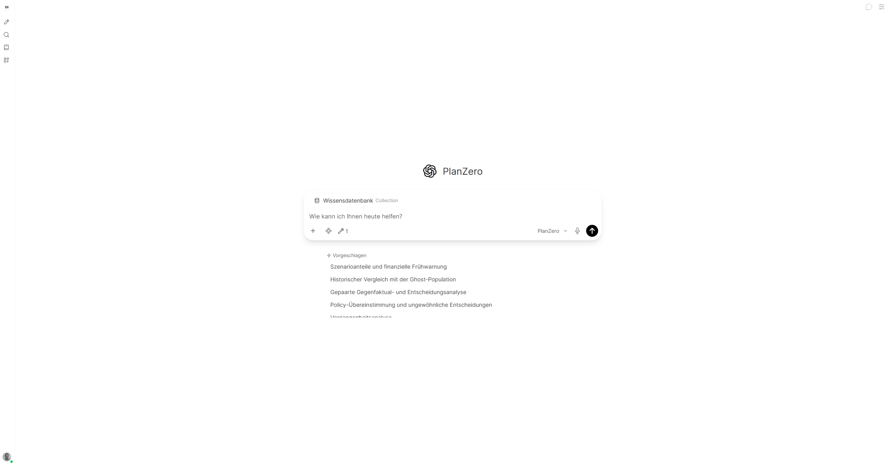
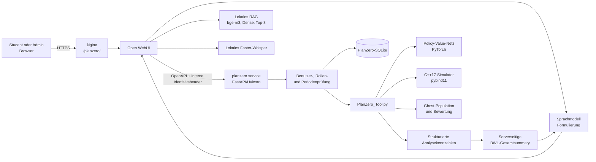
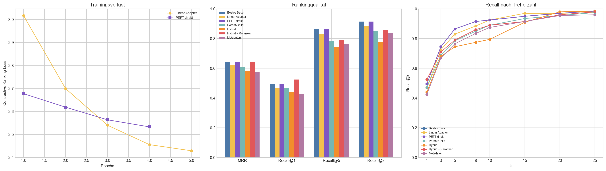
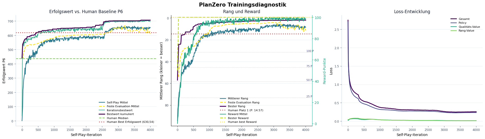
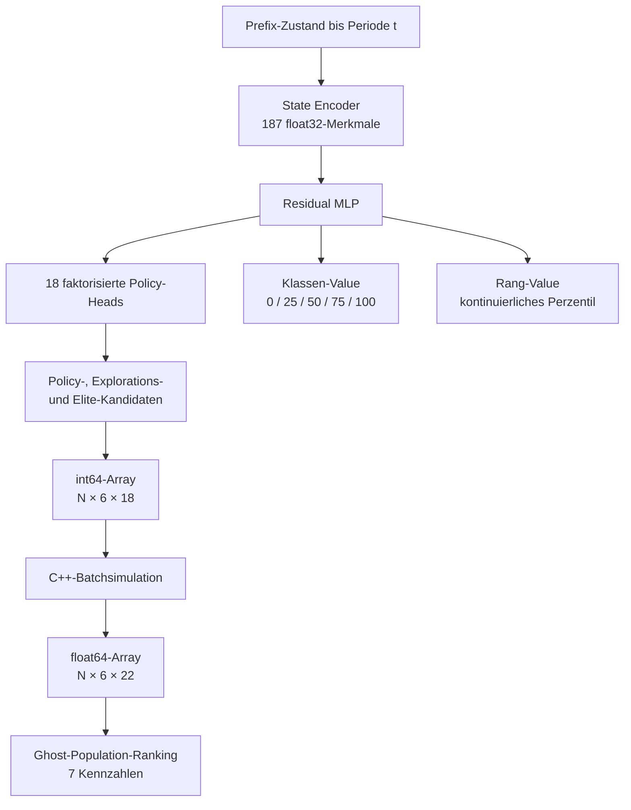
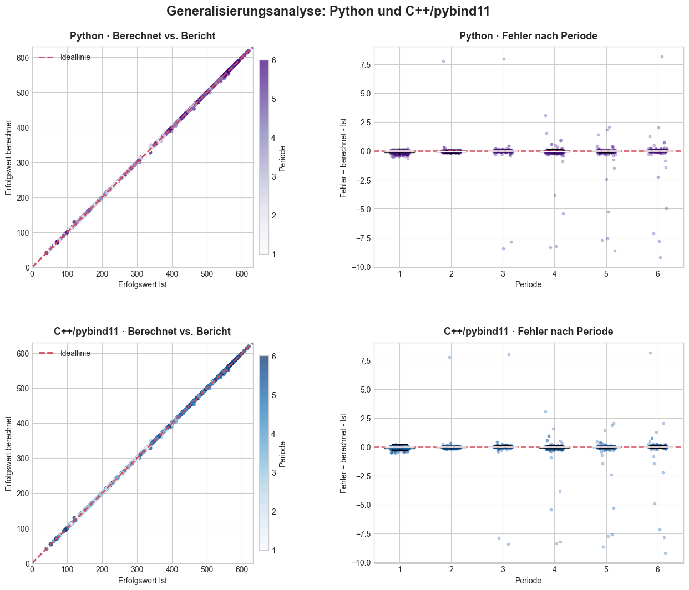
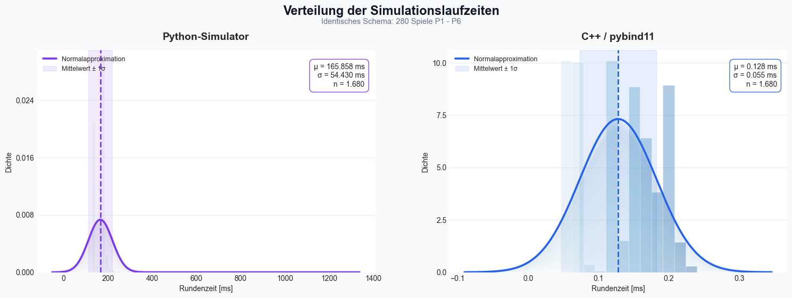

# PlanZero

**verteiltes Actor Critic Deep Reinforment Learning System in sechsperiodiger Business-Simulationen (bestärkendes Lernen)**

PlanZero bewältigt einen kombinatorischen Entscheidungsraum mit theoretisch etwa **4,68 × 10¹⁵¹ möglichen Aktionsfolgen** in seinen sechs Perioden – rund 29 Größenordnungen mehr als die geschätzte Spielbaumkomplexität von Schach.

> **Forschungsfrage:** Wie lässt sich eine rekonstruierte, deterministische
> Unternehmenssimulation mit AlphaZero-artiger Policy-Value-Planung und
> erklärbarer KI verbinden, ohne die Eigenständigkeit studentischer
> Entscheidungen aufzuheben? (gelöst) Wie interagieren Studenten mit einer Superhuman-KI? Wie verändern sich die Noten? Wie robust ist das System gegen irrationale menschliche Entscheidungen?

PlanZero verbindet ein explizites, reportfreies Weltmodell mit einem trainierten
Policy-Value-Netz, einem nativen C++17-Simulator und einer produktiven
OpenAPI-Schnittstelle. Der Dienst rekonstruiert die freigegebene Vergangenheit,
simuliert bedingte Fortsetzungen, lokale Sensitivitäten und gepaarte
Gegenfakten und formuliert daraus serverseitig eine verständliche
BWL-Gesamtanalyse.



>**Forschungsfrage:** Vertrauen Studierende, die den Agenten intensiv nutzen, den Analysen blind, oder verbessert die Erklärbarkeit (XAI) ihr eigenes strategisches Verständnis?
>Gibt es eine Korrelation zwischen der Länge/Tiefe der Chat-Fragen (z. B. tiefgehende Warum-Fragen vs. kurze Kontrollfragen) und dem Schlussrang im Planspiel?
>Wie verändert sich das Interaktionsverhalten von Periode 1 bis Periode 6? Werden die Fragen abstrakter/komplexer, weil die Studierenden das Spiel durch die KI besser verstehen?
>Hilft der DRL-Agent schwächeren Studierenden überproportional stark (Closing the Gap), oder profitieren vor allem die ohnehin starken Studierenden (Matthäus-Effekt)?

Die studentische Oberfläche läuft in Open WebUI. Identität, Rolle, Spielnummer,
Unternehmen und aktive Periode werden außerhalb des Sprachmodells bestimmt.
Normale Nutzer erhalten keine konkreten zukünftigen Entscheidungswerte; diese
sind ausschließlich über eine gesondert freigegebene Adminfrage verfügbar.

Zum Gesamtprojekt gehört außerdem ein separates RAG-Evaluations-Repository. Es
liefert die empirische Grundlage für das lokale Dokumentenretrieval in Open
WebUI. Dieses RAG ergänzt allgemeine Fachfragen um passende Textpassagen, ist
aber keine Quelle für benutzerbezogene Spielstände oder PlanZero-Berechnungen.

## Projektstatus

| Komponente | Stand |
|---|---|
| Rekonstruktion des Environments | implementiert und historisch validiert |
| Paralleler C++17-Simulator über `pybind11` | implementiert und produktiv auf ARM64 gebaut |
| Faktorisiertes Policy-Netz mit zwei Value-Heads | trainiert; Endcheckpoint produktiv geladen |
| Bedingte Rollouts, Sensitivitäten und Gegenfakten | implementiert |
| SQLite-Daten- und Periodenfreigabe | implementiert |
| FastAPI-/OpenAPI-Microservice | produktiv integriert |
| Open-WebUI-Toolserver mit Rollenprüfung | produktiv integriert |
| Open-WebUI-RAG-Retrieval | evaluiert; `BAAI/bge-m3`, Dense Retrieval und Top-8 ausgewählt |
| Serverseitige, nicht präskriptive BWL-Summary | implementiert |
| Persistente Override-Wartezeiten und Periodenbudget | implementiert; zehn Erfolge pro Nutzer und Periode |
| Datensparsame Langfuse-Instrumentierung | implementiert, fail-open |
| Automatischer Crawler | Datenvertrag definiert, noch separat umzusetzen |
| Unabhängiger Superhuman-Arena-Nachweis | noch ausstehend |

Die Simulation selbst verwendet **kein Machine Learning**. Markt-, Betriebs-,
Finanz- und aggregierte Zielgrößen entstehen aus rekonstruierten
Wirkungskurven, festen Szenarioregeln und chronologischen Zustandsübergängen.
Deep Learning kommt bei Policy, Value-Schätzung und der Erzeugung von
U1-Strategiefortsetzungen zum Einsatz.

## Gesamtarchitektur



Open WebUI, das Sprachmodell und PlanZero haben getrennte Aufgaben:

- Open WebUI authentifiziert Nutzer, verwaltet Chats und setzt beim Toolaufruf
  die internen Identitätsheader.
- Das lokale RAG stellt für allgemeine Fachfragen empirisch ausgewählte
  Dokumentpassagen bereit. Es hat keinen Zugriff auf die PlanZero-SQLite-Daten
  und ersetzt keine Toolanalyse.
- Das Sprachmodell erkennt die Fragekategorie, ruft PlanZero auf und gibt die
  bereits fertige Summary verständlich wieder.
- `planzero_api.py` erzwingt Identität, Rolle, Serverperiode und Datenfreigabe.
- `PlanZero_Tool.py` führt Inferenz und sämtliche numerischen Analysen aus.
- `simulation.cpp` berechnet die deterministischen Zustandsübergänge.
- `planzero_api.py` rendert aus den strukturierten Ergebnissen die
  rollengeschützte BWL-Gesamtanalyse. Ein großer Rohkontext wird nicht an das
  Sprachmodell ausgeliefert.

Der Microservice verwendet genau einen Uvicorn-Worker. Weil der native
Simulator prozessglobalen Zustand besitzt, serialisiert `_NATIVE_LOCK`
vollständige Analysen; innerhalb einer Analyse darf der native Batch weiterhin
mehrere Worker verwenden.

## RAG-Retrieval-Evaluation als separates Teilprojekt

Das eigenständige RAG-Eval-Repository untersucht, welche
Retrieval-Konfiguration geeignete Textabschnitte zuverlässig für Open WebUI
bereitstellt. Die Evaluation trennt damit zwei fachlich verschiedene
Wissenspfade:

- **RAG:** statische Dokumente und allgemeines Fachwissen als ergänzender
  Kontext für normale Chats.
- **PlanZero-Tool:** serverseitig berechnete Quelle für
  benutzer-, spiel- und periodenbezogene Analysen.

RAG-Treffer dürfen weder Benutzeridentität und Rollenrechte noch Spielnummer,
aktive Periode, SQL-Cutoff oder numerische PlanZero-Ergebnisse überschreiben.
Bei einer PlanZero-Frage bleibt die rollengeschützte Tool-Summary maßgeblich.

### Versuchsaufbau

Der untersuchte Dokumentbestand wurde in 48 inhaltlich geschlossene Chunks
zerlegt. Überschriften strukturieren die Quelle, werden aber nicht Bestandteil
der Textchunks. Für jeden Chunk wurden manuell 20 unterschiedliche Nutzerfragen
formuliert. Die Aufteilung erfolgte gruppiert nach Zielchunks:

| Split | Chunks | Fragen |
|---|---|---:|
| Training | 30 | 600 |
| Validation | 8 | 160 |
| Test | 10 | 200 |

Fragen desselben Chunks gelangen dadurch nicht gleichzeitig in Training und
finale Test. Externe Paper-Chunks dienen ausschließlich als
Trainingsnegative; sie werden weder durchsucht noch evaluiert.

Verglichen wurden drei Embedding-Modelle sowie Dense Retrieval, ein linearer
Adapter, partielles direktes Fine-Tuning, Parent-Child Retrieval, hybride
BM25-Suche, Cross-Encoder-Reranking und Metadaten-Retrieval. Die Bewertung
verwendet:

### Mean Reciprocal Rank

$\displaystyle \mathrm{MRR}=\frac{1}{|Q|}\sum_{i=1}^{|Q|}\frac{1}{r_i}$

Die MRR gewichtet frühe Treffer besonders stark. Der Wertebereich liegt zwischen 0 und 1; ein höherer Wert ist besser. Eine MRR von 1 bedeutet, dass der korrekte Chunk bei jeder Frage an erster Stelle steht. Die MRR ist nicht selbst die mittlere Listenposition, sondern der Mittelwert ihrer Kehrwerte.

### Mean Rank

$\displaystyle \mathrm{MeanRank}=\frac{1}{|Q|}\sum_{i=1}^{|Q|}r_i$

Der Mean Rank gibt die durchschnittliche Position des korrekten Chunks in der Ergebnisliste an. Hier ist ein kleinerer Wert besser; der optimale Wert ist 1.

### Recall@k

$\displaystyle \mathrm{Recall@}k=\frac{1}{|Q|}\sum_{i=1}^{|Q|}\mathbb{1}(r_i\leq k)$

Die Indikatorfunktion $\mathbb{1}(r_i\leq k)$ nimmt den Wert 1 an, wenn der korrekte Chunk unter den ersten $k$ Treffern liegt, andernfalls 0. Da jede Frage genau einem Zielchunk zugeordnet ist, entspricht Recall@k hier dem Anteil der Fragen, für die dieser Zielchunk in den Top-k gefunden wird. Ein höherer Wert ist besser.

### Ergebnisse



| Verfahren | MRR | Mean Rank | Recall@1 | Recall@5 | Recall@8 |
|---|---:|---:|---:|---:|---:|
| Bestes Base-Modell | 0,6444 | 3,555 | 0,495 | 0,865 | 0,915 |
| Linear Adapter | 0,6239 | 3,740 | 0,470 | 0,830 | 0,885 |
| Direktes partielles Fine-Tuning | 0,6444 | 3,555 | 0,495 | 0,865 | 0,915 |
| Parent-Child | 0,6086 | 4,435 | 0,470 | 0,785 | 0,850 |
| Hybrid | 0,5809 | 5,140 | 0,440 | 0,745 | 0,775 |
| Hybrid + Reranker | **0,6453** | 4,660 | **0,525** | 0,790 | 0,860 |
| Metadaten-Retrieval | 0,5749 | 4,900 | 0,425 | 0,765 | 0,835 |

`BAAI/bge-m3` erzielte im Modellvergleich die besten Tuning-Ergebnisse. Das
unveränderte Base-Modell erreicht auf der strikt getrenntem Test einen
Recall@5 von 86,5 % und einen Recall@8 von 91,5 %. Die zusätzlichen drei
Treffer erhöhen die Abdeckung damit um 5,0 Prozentpunkte; deshalb verwendet der
Betrieb bewusst `k = 8`.

Adapter und partielles Fine-Tuning liefern keinen belastbaren
Validierungsvorteil. Dies ist im Hinlbick auf die mit 600 Fragen geringe Trainingsmenge nicht verwunderlich.
Hybrid + Reranker verbessert die MRR lediglich von 0,6444
auf 0,6453 und den Recall@1 von 49,5 % auf 52,5 %, senkt aber Recall@5 und
Recall@8. Gleichzeitig steigt die lokal gemessene CPU-Latenz pro Frage von
30,6 ms auf 1161,8 ms. Modellladezeit und Indexaufbau sind in diesen Werten
nicht enthalten. Der geringe Gewinn rechtfertigt daher weder die zusätzliche
Latenz noch die höhere Komplexität.

## Datenfluss einer Analyse

1. Open WebUI authentifiziert den Nutzer und übermittelt User-ID, Name,
   E-Mail-Adresse und Rolle in vier für das Modell unsichtbaren Headern.
2. `planzero_api.py` prüft Rolle und Frageberechtigung. Fehlender Kontext führt
   zu `401`, eine gesperrte Frage zu `403` und ein fehlendes Mapping zu `404`.
3. `user_game_mapping` ordnet den Nutzer serverseitig einer pseudonymisierten
   Szenario- und Teilnehmerinstanz zu.
4. `settings.py` bestimmt anhand der Serverzeit in `Europe/Berlin` die aktive
   Periode N und deren Abgabefrist. Eine abweichend angeforderte Periode wird
   mit `422` abgelehnt.
5. `SQLDecisionStore` lädt für U1 nur abgeschlossene Perioden bis P(N−1),
   ergänzt den offiziellen P0-Zustand und verbindet sie mit dem vollständigen,
   versionierten U2–U6-Gegnerszenario für P1–P6.
6. Das Policy-Netz leitet die aktuelle U1-Entscheidung aus der freigegebenen
   Historie ab. Ein ausdrücklich angegebener Override verändert nur diese
   aktuelle Modellentscheidung und keine SQL-Daten.
7. Der native Simulator berechnet Vergangenheit, Referenzverlauf, bedingte
   Zukunfts-Rollouts, lokale Sensitivitäten und gepaarte Gegenfakten.
8. Die API erzeugt daraus eine vollständige Summary mit Zeitkontext,
   Datenabgrenzung, Kennzahlen, Unsicherheiten und Warnhinweisen.

Die Beschreibung des OpenAPI-Tools weist das Sprachmodell an, PlanZero pro
zusammenhängendem Analysezustand **genau einmal** aufzurufen. Folgefragen werden
aus der bereits im Chat vorhandenen Gesamtsummary beantwortet. Das ist eine
Modellinstruktion, kein serverseitiger Chat-Lock: Ein technisch erneut
gesendeter gültiger Request würde erneut berechnet, sofern die zusätzliche
serverseitige Override-Begrenzung ihn zulässt. Diese Grenze gilt unabhängig von
der Modellinstruktion und wird im folgenden Abschnitt beschrieben.

## Beispiel: Nutzeranfrage in der aktiven Periode 3

Bei einer Anfrage in P3 lädt PlanZero für U1 ausschließlich die abgeschlossenen
Entscheidungen aus P1 und P2. Die aktuelle P3-Entscheidung wird nicht aus SQL
gelesen, sondern aus der Policy abgeleitet; ein ausdrücklich angegebener
Nutzer-Override würde nur diese P3-Entscheidung verändern. Sie bleibt in allen
bedingten Fortsetzungen fixiert. Erst die U1-Entscheidungen für P4 bis P6
variieren zwischen den standardmäßig 128 Rollouts. Alle historischen und
simulierten Verläufe treten dabei gegen dieselben festen U2–U6-Entscheidungen
des Szenarios `standardgegner_v1` an.

```mermaid
flowchart LR
    Q([Nutzeranfrage in P3]) --> API[API prüft Identität, Rolle und Frage<br/>ordnet Spielnummer zu und bestätigt Serverperiode 3]

    subgraph T[Freigegebener Zustand und aktuelle Entscheidung]
        direction LR
        P0[P0<br/>offizieller gemeinsamer<br/>Ausgangszustand]
        P1[P1 abgeschlossen<br/>U1-Entscheidung aus SQL]
        P2[P2 abgeschlossen<br/>U1-Entscheidung aus SQL]
        INF[Policy- und<br/>Value-Inferenz]
        P3[P3 aktuell<br/>Policy-Modus oder<br/>ausdrücklicher Override<br/>keine P3-SQL-Zeile]
        P0 --> P1 --> P2 --> INF --> P3
    end

    API --> P0
    OPP[Feste Gegner U2–U6<br/>P1 bis P6<br/>standardgegner_v1]
    P2 --> PAST[C++-Rekonstruktion<br/>der Vergangenheit P1–P2]
    OPP -. unverändert .-> PAST

    P3 --> BATCH[C++-Batch<br/>128 bedingte U1-Rollouts<br/>P3 in allen Verläufen fixiert]
    OPP -. in jedem Verlauf unverändert .-> BATCH

    subgraph R[Repräsentative Simulationsverläufe — insgesamt 128]
        direction LR
        A4[P4 · Verlauf 1] --> A5[P5 · Verlauf 1] --> A6[P6 · Verlauf 1]
        B4[P4 · Verlauf 2] --> B5[P5 · Verlauf 2] --> B6[P6 · Verlauf 2]
        X4[P4 · Verläufe 3–127] --> X5[P5 · Verläufe 3–127] --> X6[P6 · Verläufe 3–127]
        Z4[P4 · Verlauf 128] --> Z5[P5 · Verlauf 128] --> Z6[P6 · Verlauf 128]
    end

    BATCH --> A4
    BATCH --> B4
    BATCH --> X4
    BATCH --> Z4

    A6 --> AGG[Aggregation aller P3–P6-Verläufe<br/>Mediane, Bandbreiten, Szenarioanteile<br/>und finanzielle Warnindikatoren]
    B6 --> AGG
    X6 --> AGG
    Z6 --> AGG

    PAST --> EXTRA[Zusatzanalysen<br/>Vergangenheit, Policy-Abweichungen,<br/>lokale Sensitivitäten und Gegenfakten]
    P3 --> EXTRA
    AGG --> GHOST[Ghost-Vergleich und<br/>Bewertung bis P6]
    EXTRA --> SUM[Serverseitige BWL-Gesamtsummary<br/>alle Bereiche 1–7 gemeinsam]
    AGG --> SUM
    GHOST --> SUM
    SUM --> OW[Open WebUI gibt die Summary wieder<br/>Adminfrage ergänzt konkrete Entscheidungswerte]

    classDef history fill:#dbeafe,stroke:#2563eb,color:#111827;
    classDef current fill:#fef3c7,stroke:#d97706,color:#111827;
    classDef future fill:#dcfce7,stroke:#16a34a,color:#111827;
    classDef fixed fill:#f3e8ff,stroke:#9333ea,color:#111827,stroke-dasharray:5 5;
    classDef result fill:#f3f4f6,stroke:#4b5563,color:#111827;
    class P0,P1,P2,PAST history;
    class INF,P3,BATCH current;
    class A4,A5,A6,B4,B5,B6,X4,X5,X6,Z4,Z5,Z6 future;
    class OPP fixed;
    class API,AGG,EXTRA,GHOST,SUM,OW result;
```



Die vier gezeichneten Äste stehen exemplarisch für das gesamte Ensemble; der
mittlere Ast fasst die Verläufe 3 bis 127 nur zur besseren Lesbarkeit zusammen.
PlanZero bewertet nicht bloß einen vermeintlich „besten“ Pfad: Die Summary
trennt den einzelnen Referenzverlauf von den Medianen und Bandbreiten aller 128
Fortsetzungen. Zusätzlich werden aktuelle P3-Alternativen lokal und gepaart
unter kontrollierten Zukunftsbedingungen geprüft, bevor die sieben
nicht präskriptiven Analysebereiche zusammengeführt werden.

## Datenmodell und Schutz vor Zukunftsdaten

Die produktive SQLite-Datenbank enthält vier fachliche Tabellen:

| Tabelle | Aufgabe |
|---|---|
| `user_game_mapping` | Zuordnung von Open-WebUI-Nutzern zu Spielnummer und Unternehmen |
| `period_decisions` | individuelle, validierte U1-Entscheidungen mit 20 kanonischen Feldern |
| `opponent_scenarios` | Metadaten und Aktivstatus versionierter Gegnerszenarien |
| `opponent_scenario_decisions` | vollständige U2–U6-Entscheidungen eines Szenarios |

Die kanonische Spielnummer besteht aus genau sechs ASCII-Ziffern. Das aktive
Szenario `standardgegner_v1` umfasst exakt `6 Perioden × 5 Gegner = 30` Zeilen.
Bei aktiver Periode N dürfen aus `period_decisions` nur U1-Zeilen bis P(N−1)
einfließen:

| Aktive Periode | Freigegebene individuelle U1-Historie |
|---:|---|
| P1 | keine U1-Zeile |
| P2 | P1 |
| P3 | P1–P2 |
| P4 | P1–P3 |
| P5 | P1–P4 |
| P6 | P1–P5 |

Bereits gespeicherte aktuelle oder zukünftige U1-Zeilen bleiben durch den
SQL-Cutoff ausgeschlossen. Der Store erzeugt intern die vom Simulator
erwarteten 42 Zeilen aus:

- sechs offiziellen P0-Zeilen,
- 30 festen U2–U6-Zeilen für P1–P6,
- den freigegebenen U1-Zeilen bis P(N−1),
- deutlich markierten technischen U1-Platzhaltern von P(N) bis P6.

Die Platzhalter sind keine historische Evidenz. Die aktuelle U1-Entscheidung
kommt aus dem Policy-Modus, spätere U1-Entscheidungen entstehen ausschließlich
in den Modell-Rollouts. Der native Cache berücksichtigt neben der Spielnummer
eine Signatur der freigegebenen Konfigurationsdaten und wird bei neuen
Crawlerdaten oder einem Periodenwechsel zuverlässig invalidiert.

## Analyseumfang und Rollenmodell

PlanZero unterstützt folgende Analysebereiche:

1. Vergangenheitsanalyse
2. (Bedingte Zukunfts-Rollouts) – Ausgabe derzeit deaktiviert
3. Lokale Sensitivitätsanalyse
4. Gepaarte Gegenfaktual- und Entscheidungsanalyse
5. Historischer Vergleich mit der Ghost-Population
6. Policy-Übereinstimmung und ungewöhnliche Entscheidungen
7. Szenarioanteile und finanzielle Frühwarnung
8. Konkrete nächste Modellentscheidungen – ausschließlich für Admins

Studierende erhalten eine betriebswirtschaftliche Zusammenfassung mit
Erklärungen, Wirkungsrichtungen, Zielkonflikten und Warnhinweisen. Der eigene
Abschnitt zu bedingten Zukunfts-Rollouts ist derzeit deaktiviert. Eine fertige
Liste optimaler Eingabewerte wird Studierenden nicht vorgegeben.

Eigene Entscheidungsvorschläge können innerhalb der unten beschriebenen
Wartezeiten und des Periodenbudgets geprüft werden. Die Ergebnisse unterstützen
die eigene Abwägung; sie garantieren keine optimale Entscheidung.

Nur die gesondert freigegebene Adminfrage stellt konkrete aktuelle und spätere
Modellentscheidungen bereit. Benutzerrolle, Spielzuordnung und aktuelle Periode
werden serverseitig bestimmt.

## Eigene Entscheidungsvarianten: Wartezeiten und Periodenbudget

Studierende können eigene aktuelle Entscheidungen als Overrides prüfen lassen.
Damit wiederholte Abfragen nicht zur unbegrenzten automatisierten Suche nach
optimalen Eingabewerten werden, gilt ein serverseitiges
Budget von **zehn erfolgreichen Override-Prüfungen pro Nutzer und Spielperiode**.
Die Wartezeit beginnt jeweils nach einer erfolgreichen Prüfung:

| Erfolgreiche Prüfung | Wartezeit bis zur nächsten eigenen Variante |
|---|---|
| 1 und 2 | keine zusätzliche Wartezeit |
| 3 | 5 Minuten |
| 4 | 15 Minuten |
| 5 | 30 Minuten |
| 6 bis 9 | 3 Stunden |
| 10 | Budget bis zur nächsten Spielperiode aufgebraucht |

Die Antwort nennt den bisherigen Verbrauch, das Restbudget und gegebenenfalls
Datum und Uhrzeit der nächsten Freigabe in `Europe/Berlin`. Diese Hinweise stehen
in `summary` und `validation_warnings`; andere Validierungswarnungen bleiben
sichtbar. Ungültige Eingaben und fehlgeschlagene Analysen verbrauchen kein Budget.
Abgewiesene Wiederholungen verlängern die Wartezeit nicht.

Neue Chats, Abmelden, Neustarts sowie andere Fragekategorien oder technische
Parameter setzen die Grenzen nicht zurück. Eine neue serverseitige Spielperiode
beginnt mit einem neuen Budget. Es gibt keine Adminausnahme. **Analysen ohne eigene
Entscheidungs-Overrides und Verständnisfragen bleiben verfügbar.**

Der Server antwortet bei einer vorübergehenden Wartezeit mit HTTP `429` und
`override_cooldown`, bei einer bereits laufenden Prüfung mit `override_in_progress`
und bei aufgebrauchtem Budget gesondert mit `override_budget_exhausted`. Die
Fehlermeldung erklärt den Grund und die weiteren Möglichkeiten. Bei Wartezeit
oder laufender Prüfung wird zusätzlich `Retry-After` geliefert. Das Sprachmodell
soll blockierte Aufrufe nicht automatisch wiederholen.

Die Speicherung erfolgt pro stabiler Nutzer-ID und serverseitigem Periodenbeginn
in der separaten SQLite-Datei `data/override_limits.sqlite3`. Atomare Reservierungen
verhindern parallele Override-Berechnungen desselben Nutzers in derselben Periode.
Ein bereits erfolgreich abgeschlossener Aufruf bleibt auch bei anschließendem
Verbindungsabbruch gezählt. Die Grenze gilt pro Konto; sie verhindert keinen
Ergebnisaustausch zwischen verschiedenen Personen.

Die Umsetzung wurde mit **14 isolierten Tests und zwei Starttests** geprüft.
Zusätzlich bestätigte ein ausdrücklich gestarteter synthetischer Langfuse-Test
mit temporärer Datenbank und simulierter Engine die Erfassung von Wartezeit,
Budgetende und weiterhin verfügbaren normalen Analysen. Dabei wurden keine
studentischen Budgets verwendet. Dieser Nachweis ersetzt keinen vollständigen
Modell-/Simulator- oder Browser-End-to-End-Test.

## Periodensteuerung

Die sechs Fenster sind zeitzonenbewusst und halboffen
(`start <= Zeitpunkt < end`). An einem gemeinsamen Grenztag wechselt die
Periode exakt um 10:00 Uhr in `Europe/Berlin`.


| Periode | Beginn | Ende / Abgabefrist |
|---:|---|---|
| P1 | 02.11.2026, 10:00 | 16.11.2026, 10:00 |
| P2 | 16.11.2026, 10:00 | 30.11.2026, 10:00 |
| P3 | 30.11.2026, 10:00 | 14.12.2026, 10:00 |
| P4 | 14.12.2026, 10:00 | 04.01.2027, 10:00 |
| P5 | 04.01.2027, 10:00 | 11.01.2027, 10:00 |
| P6 | 11.01.2027, 10:00 | 18.01.2027, 10:00 |

Außerhalb dieser Fenster lehnt der Dienst Analysen mit `422` ab. Jede Summary
beginnt mit dem einmal pro Request ermittelten Serverdatum, der Uhrzeit, der
aktiven Periode und ihrer Abgabefrist.

## Ergebnis des abgeschlossenen Trainingslaufs



Der Lauf vom 29. Juli 2026 wurde auf einem Intel Core i7-14600KF mit vier nativen
Workern und einer NVIDIA GeForce RTX 4070 Ti vollständig abgeschlossen.

| Kennzahl | Ergebnis |
|---|---:|
| Trainingsdauer | 901,9 Minuten (ca. 15 Stunden 2 Minuten) |
| Self-Play-Iterationen | 4.000 |
| Self-Play-Partien | 512.000 (128 je Iteration) |
| Kandidaten je Zustand | 64 |
| vollständige P1–P6-Simulationen im Self-Play | 196.608.000 |
| vollständige P1–P6-Simulationen einschließlich fester Evaluation | 204.521.472 |

Das Modell lernte zunächst schnell, verbesserte sich nach einer längeren
Plateauphase ab etwa Iteration 2.600 erneut und erreichte seine stärkste feste
Evaluation in Iteration 3.200: einen mittleren Simulationsscore von **668,62** und
einen mittleren Rang von **4,01**. Die Ghost Population umfasst 107 vollständig
bewertete Spielergebnisse von Studierenden aus dem Sommersemester 2026. Die
historischen Vergleichsmarken liegen bei einem Simulationsscore von 630,54 und einem
Rang von 14,57 (kleiner ist besser). Der beste einzelne Plan des Laufs erreichte
706,07 und einen Rang von 2,43; der höchste Self-Play-Mittelwert lag bei 665,78.

Gegen Ende blieb das Self-Play mit 655,05 Punkten stark, während die feste Evaluation auf 609,74 Punkte beziehungsweise Rang 11,62 zurückging. Der Loss fiel dennoch von 2,7483 auf 0,2546, was im Reinforcement Learning nicht ungewöhnlich ist. Es spricht für eine späte Spezialisierung auf die Trainingssuche und gegen die Annahme, dass der niedrigste Loss automatisch den am besten generalisierenden Checkpoint liefert. Vorrangig wird hier der Gesamtreward betrachtet. Dieser ist aus der identischen Bewertungsmatrix konstruiert, auf der auch die Studierenden evaluiert werden, was das Alignment-Problem auflöst.

## Policy-Value- und Simulationsarchitektur

PlanZero übernimmt von AlphaZero die Kombination aus explizitem Weltmodell,
Policy-Prior und langfristiger Value-Schätzung. Es ist jedoch weder ein
unverändertes Zwei-Spieler-Nullsummenverfahren noch klassische PUCT-MCTS. Das
Planspiel ist ein deterministisches, mehrperiodiges Planungsproblem mit einem
breiten, faktorisierten Management-Aktionsraum.



Der Encoder bildet den chronologischen U1-Entscheidungs- und Ergebnisverlauf
auf 187 Merkmale ab. Das Netz besitzt 18 periodenabhängig maskierte
Policy-Heads sowie zwei Value-Heads:

- Der Klassen-Value lernt die diskrete Rewardklasse `0/25/50/75/100`.
- Der Rang-Value lernt das kontinuierliche Rangperzentil gegenüber der festen
  Ghost Population.

Die Suche verbessert lokale Kandidaten in großen Batches. Vollständige
Fortsetzungen werden als dichte Arrays an den C++-Simulator übergeben; Excel
oder Ergebnisreports werden dabei nicht gelesen. Das vermeidet eine
Python-basierte Baumexpansion über den kartesischen Produktraum aller
Entscheidungsdimensionen.

Der Simulator verarbeitet unter anderem Preis, Werbung, Vertrieb, Qualität,
Produktion, Einsatzstoffe, Personal, Investitionen, Finanzierung, Lager,
Liquidität und Bilanz. Ein Lauf umfasst chronologisch Marktreaktionen,
Lieferfähigkeit, Nachfrageumverteilung, betriebliche Abrechnung, Finanzierung
und die Bildung aggregierter Zielkennzahlen.


# MDP- und Spielbaumkomplexität

## 1. Markov Decision Process (MDP)

Ein MDP lässt sich durch das Tupel

$$
\mathrm{MDP}=(S,A,P,R)
$$

beschreiben. Dabei stehen $S$ für den Zustandsraum, $A$ für den Aktionsraum, $P$ für die Übergangswahrscheinlichkeiten und $R$ für die Belohnungsfunktion. Bei einem endlichen Planungshorizont werden zusätzlich der Horizont $H$ und gegebenenfalls eine Anfangszustandsverteilung angegeben. Ein Diskontierungsfaktor $\gamma$ kann ebenfalls Bestandteil der Definition sein.

Für PlanZero beträgt der vollständige Horizont sechs Entscheidungsperioden. Damit die Markov-Eigenschaft erfüllt ist, muss der Zustand alle Informationen enthalten, die den nächsten Übergang und die Bewertung beeinflussen. Dazu gehören insbesondere die aktuelle Periode und die relevanten internen Simulatorgrößen. Eine Auswahl sichtbarer betriebswirtschaftlicher Kennzahlen allein ist nicht automatisch ein vollständiger Markov-Zustand.

Bei festgelegten Gegnerentscheidungen und einer vollständig bestimmten Simulatorkonfiguration ist der Übergang deterministisch:

$$
s_{t+1}=f_t(s_t,a_t),
\qquad
P_t(s'\mid s,a)=
\begin{cases}
1,&s'=f_t(s,a),\\
0,&\text{sonst}.
\end{cases}
$$

Diese MDP-Betrachtung gilt für das **PlanZero-Weltmodell mit festem Gegnerszenario**. Würden die Gegner selbst strategisch auf eigene Entscheidungen reagieren, läge ein Mehragenten Szenario vor.

## 2. Kombinatorischer Aktionsraum pro Periode

Für unabhängig kombinierbare diskrete Entscheidungsfelder ergibt sich der kartesische Produktraum als

$$
b_t^{\mathrm{Raster}}=\prod_{i=1}^{n}|G_{i,t}|,
$$

wobei $G_{i,t}$ die Wertemenge des Feldes $i$ in Periode $t$ bezeichnet.

Für ein regelmäßiges Raster gilt:

$$
|G_i|=
\left\lfloor
\frac{\mathrm{High}_i-\mathrm{Low}_i}{\mathrm{Step}_i}
\right\rfloor+1.
$$

Das exakte Produkt beträgt:

```math
b_{\mathrm{P5}}^{\mathrm{Basis}} = 4\,091\,981\,056\,814\,276\,246\,870\,205\,530\,112 \approx 4{,}091981 \times 10^{30}
```

## 3. Periodenabhängige Verzweigung

| Periode | Felder mit mehr als einem Wert | Kartesischer Basisaktionsraum |
|---|---:|---:|
| P1 | 8 | $1{,}449897\times10^{13}$ |
| P2 | 12 | $1{,}500816\times10^{20}$ |
| P3 | 16 | $9{,}531752\times10^{26}$ |
| P4 | 18 | $1{,}930180\times10^{30}$ |
| P5 | 18 | $4{,}091981\times10^{30}$ |
| P6 | 18 | $2{,}856666\times10^{30}$ |


## 4. Anzahl vollständiger Aktionsfolgen

Die Anzahl vollständiger Aktionsfolgen ergibt sich als Produkt der sechs
periodenabhängigen Basisaktionsräume:

```math
C_{\mathrm{Basis}} = \prod_{t=1}^{6} b_t^{\mathrm{Basis}} \approx 4{,}679808 \times 10^{151}
```

## 5. Vergleich mit Schach und Go

Für Schach und Go nennt der begutachtete Übersichtsartikel von **van den Herik, Uiterwijk und van Rijswijck (2002), Tabelle 2**, geschätzte Spielbaumkomplexitäten von 10¹²³ beziehungsweise 10³⁶⁰ [1]. Diese Literaturwerte sind grobe Abschätzungen und keine exakten Anzahlen sämtlicher legaler Partien.

| Beispiel | Angenommene Verzweigung | Angenommene Tiefe | Eigene Modellrechnung | Literaturabschätzung [1] |
|---|---:|---:|---:|---:|
| Schach | 35 | 80 Halbzüge | 35⁸⁰ ≈ 3,35 × 10¹²³ | 10¹²³ |
| PlanZero, periodenabhängige Basisraster | unterschiedlich | 6 Perioden | Produkt der sechs Basisaktionsräume ≈ 4,68 × 10¹⁵¹ | – |
| PlanZero, konstantes P5-Basisraster | 4,09 × 10³⁰ | 6 Perioden | (P5-Basisaktionsraum)⁶ ≈ 4,69 × 10¹⁸³ | – |
| Go (19 × 19) | 250 | 150 einzelne Züge | 250¹⁵⁰ ≈ 4,91 × 10³⁵⁹ | 10³⁶⁰ |

Die Annahmen b ≈ 35 und d ≈ 80 für Schach sowie b ≈ 250 und d ≈ 150 für Go werden auch im begutachteten Nature-Artikel von Silver et al. (2016) verwendet [2]. Die Spalte „Eigene Modellrechnung“ zeigt die daraus berechneten Werte; die Literaturabschätzungen stammen aus [1].

Der Vergleich ist eingeschränkt: Ein Schachhalbzug oder Go-Zug ist eine einzelne Spielerentscheidung; eine PlanZero-Aktion kombiniert zahlreiche wirtschaftliche Entscheidungen.

## Ghost Population und Reward

Die offizielle Bewertungsmatrix wird beim
Erzeugen der Reward-Klasse dabei einmalig eingelesen.

Die feste Ghost Population bewertet Pläne über sieben Kennzahlen:

1. kumulierte finanzielle Leistungsgröße,
2. multidimensionaler Simulationsscore,
3. Kapitalstabilität,
4. aggregierte Marktleistung,
5. Liquiditätsreserve,
6. Abweichung der Personalauslastung vom Zielbereich,
7. Abweichung der Kapazitätsauslastung vom Zielbereich.

Die historischen Quintilsgrenzen erzeugen die diskreten Klassen
`100 | 75 | 50 | 25 | 0`. Der zusätzliche Rang-Value liefert innerhalb einer
Klasse ein kontinuierliches Lernsignal, ohne die primäre Bewertungslogik zu
verändern.

## Simulatorvalidierung

Die Ende-zu-Ende-Validierung umfasst 280 historische Simulationsverläufe aus
zwei getrennten Datenbeständen. Für eine feste Teilnehmerinstanz werden die
Perioden P1 bis P6 jeweils in ihrer tatsächlichen zeitlichen Reihenfolge
simuliert. Damit gehen auch periodische Folgezustände in die Bewertung ein.
Insgesamt wurden 1.680 Simulationsfälle erfolgreich und ohne Fehlschlag
ausgeführt. P0 ist ein fester Anfangszustand und wird deshalb nicht als
Zielwert bewertet.

### Methodische Einordnung der Validierung

Ziel dieser Auswertung ist nicht, eine Generalisierung auf andere
Simulationssysteme nachzuweisen. Geprüft wird vielmehr, wie genau der
deterministische Simulator die beobachteten Ergebnisse innerhalb seines
vorgesehenen Einsatzbereichs reproduziert. Die 1.680 historischen Datenpunkte
wurden nicht für den Bau des Simulationscodes verwendet, sondern dienen nach
dessen Fertigstellung als unabhängige Referenzfälle zur Prüfung der
Passgenauigkeit.

Dazu werden die historischen Entscheidungen chronologisch erneut durch den
Simulator gespielt und die selbst berechneten Zielwerte anschließend mit den
zugehörigen Referenzwerten verglichen. Diese Referenzwerte sind reine
Evaluationsziele und keine Simulationsinputs. Methodisch ist dies ein
**historischer Replay-Test** beziehungsweise eine **Validierung der
Rekonstruktionsgüte** auf zuvor nicht zur Implementierung verwendeten
Beobachtungen.

Dabei bezeichnet $y_i$ den historischen Referenzwert, $\hat{y}_i$ den vom
Simulator berechneten Wert und $e_i=\hat{y}_i-y_i$ den Fehler des Falls $i$.
Die Anzahl aller bewerteten Fälle ist $N$.

### Mean Absolute Error

$\displaystyle \mathrm{MAE}=\frac{1}{N}\sum_{i=1}^{N}\left|e_i\right|=\frac{1}{N}\sum_{i=1}^{N}\left|\hat{y}_i-y_i\right|$

Der MAE ist die mittlere absolute Abweichung zwischen Simulation und Referenz.
Ein kleinerer Wert ist besser; das Optimum liegt bei 0.

### Root Mean Squared Error

$\displaystyle \mathrm{RMSE}=\sqrt{\frac{1}{N}\sum_{i=1}^{N}e_i^2}=\sqrt{\frac{1}{N}\sum_{i=1}^{N}\left(\hat{y}_i-y_i\right)^2}$

Der RMSE gewichtet große Abweichungen durch das Quadrieren stärker als der MAE
und macht dadurch den Einfluss einzelner Ausreißer sichtbar. Ein kleinerer Wert
ist besser; das Optimum liegt bei 0.

### Maximum Absolute Error

$\displaystyle \mathrm{MaxAbs}=\max_{1\leq i\leq N}\left|e_i\right|=\max_{1\leq i\leq N}\left|\hat{y}_i-y_i\right|$

MaxAbs ist die größte beobachtete absolute Abweichung und beschreibt damit den
Worst Case der untersuchten Simulationsfälle. Ein kleinerer Wert ist besser;
das Optimum liegt bei 0.

### Bias

$\displaystyle \mathrm{Bias}=\frac{1}{N}\sum_{i=1}^{N}e_i=\frac{1}{N}\sum_{i=1}^{N}\left(\hat{y}_i-y_i\right)$

Der Bias ist der mittlere vorzeichenbehaftete Fehler. Negative Werte stehen für
eine durchschnittliche Unter-, positive Werte für eine Überschätzung. Ideal
ist ein Wert von 0.

### Ergebnisqualität gegenüber den historischen Referenzdaten

| Zeitraum | N | Ø Referenzscore | MAE | RMSE | MaxAbs | Bias |
|---|---:|---:|---:|---:|---:|---:|
| **Gesamt (P1–P6)** | **1.680** | **311,67** | **0,1481** | **0,7760** | **9,2057** | **−0,0663** |
| P1 | 280 | 286,34 | 0,0980 | 0,1569 | 0,6018 | −0,0826 |
| P2 | 280 | 275,71 | 0,0740 | 0,4700 | 7,7780 | −0,0029 |
| P3 | 280 | 311,32 | 0,1336 | 0,8426 | 8,4158 | −0,0199 |
| P4 | 280 | 329,86 | 0,1843 | 0,8449 | 8,3513 | −0,1096 |
| P5 | 280 | 337,00 | 0,1891 | 0,9264 | 8,6411 | −0,1224 |
| P6 | 280 | 329,77 | 0,2098 | 1,0421 | 9,2057 | −0,0602 |

Zur Einordnung der Fehlergrößen beginnt die aggregierte Zielkennzahl im
gemeinsamen Ausgangszustand in P0 bei **288,78 Punkten**; der höchste im Projekt
beobachtete Wert beträgt **706,14 Punkte**. Der mittlere Referenzscore der 1.680
Validierungsfälle liegt bei **311,67 Punkten**. Bezogen auf diesen Mittelwert
entsprechen der Gesamt-MAE von 0,1481 rund **0,05 %** und der RMSE von 0,7760
rund **0,25 %**. Dass der RMSE deutlich über dem MAE liegt, ist auf wenige große
Ausreißer zurückzuführen; der typische Fehler ist daher wesentlich kleiner als
der Worst Case.

Die historischen Referenzwerte werden getrennt eingelesen und nicht an die
reportfrei ausgeführte Simulation übergeben. Dadurch misst die Auswertung die
Reproduktionsqualität des Simulators und keine versehentliche Übernahme
historischer Zielwerte.

### Technische Übereinstimmung von Python und C++

Zusätzlich reproduziert die C++-/pybind11-Portierung die reportfreie
Python-Logik nahezu numerisch:

| Ausgabekategorie | MaxAbs C++ gegenüber Python |
|---|---:|
| aggregierte Zielkennzahl | 0,0110 |
| finanzielle Ergebnisgröße | 0,0356 |
| monetäre Gesamtgröße | < 2 × 10⁻¹² |
| Nachfragepotenzial Kanal A | 0 |
| Nachfragepotenzial Kanal B | 0 |
| realisierte Menge | < 8 × 10⁻¹² |





## Bedeutung der C++-Portierung für Reinforcement Learning

Die C++-Portierung ist für das Reinforcement Learning entscheidend, weil Self-Play und Planung sehr viele vollständige Simulationsläufe benötigen. Die Python-/PyTorch-Seite steuert über das neuronale Netz und die Suche die Entscheidungsfindung und übergibt die gewählten Aktionen gebündelt über pybind11 an den nativen C++-Simulator. Dieser bildet das **Environment**, berechnet die chronologischen Zustandsübergänge und gibt die resultierenden Folgezustände zur weiteren Bewertung und zum Training an Python zurück.

Im Self Play wählt die Suche, geleitet durch die Policy, verschiedene Pfade im Spielbaum aus und erzeugt basierend auf der Besuchshäufigkeit der Suchknoten eine Zugwahrscheinlichkeitsverteilung. Diese ist deutlich fundierter als die anfänglich rohe Netzwerkausgabe. Die durch die Suche verbesserte Verteilung dient als Lernsignal für den Policy Head. Das Netz lernt so, die stärkere Suchausgabe vorherzusagen. Gleichzeitig liefert das tatsächliche Endergebnis der abgeschlossenen Partie in Form von Gesamtscore oder Rang in der Ghostpopulation das Lernsignal für den Value Head. Mit einer verbesserten Policy entstehen stärkere Suchkandidaten und eine genauere Value Schätzung verbessert wiederum deren Auswahl. Die dabei erzeugten Daten aus dem Self Play fließen kontinuierlich zurück in das Training, sodass sich Policy und Value iterativ gegenseitig verstärken.

Im identischen Validierungsschema sank die mittlere Rundenzeit von **165,858
ms** in Python auf **0,128 ms** in C++ – eine Beschleunigung um rund den
**Faktor 1.296**. Der abgeschlossene Trainingslauf dauerte mit dem C++-Backend
**901,9 Minuten**, also etwa **15 Stunden und 2 Minuten**. Linear mit dem
gemessenen Laufzeitfaktor hochgerechnet hätte derselbe Lauf mit dem
Python-Simulator theoretisch rund **811,6 Tage** beziehungsweise **2,22 Jahre**
benötigt. Diese Hochrechnung ist eine Größenordnung, aber keine tatsächlich
gemessene Python-Trainingsdauer.

## Didaktische und methodische Leitplanken

- **Keine Zukunftsdaten-Leakage:** Die serverseitige Periode begrenzt die
  freigegebene U1-Historie strikt auf P(N−1).
- **Keine historischen Zielwerte als Modellinput:** Historische Ergebniswerte
  dienen der festen Ghost-Population, nicht den Simulationsübergängen.
- **Keine Report-Zwischenwerte:** Marktvolumen, Absatz, Umsatz, Kosten und Bilanz
  entstehen im Weltmodell.
- **Keine ML-Näherung im Simulator:** Das Weltmodell besteht aus expliziten
  Regeln und Wirkungskurven.
- **Chronologische Zustände:** Bestände, Markt-, Personal-, Kapazitäts- und
  Finanzzustände werden periodisch fortgeschrieben.
- **Getrennte Rollen:** Studierende erhalten Analyse und Zielkonflikte, aber
  keine konkreten nächsten Entscheidungswerte.

Hinweis: Gegenfakten sind innerhalb des rekonstruierten Weltmodells kausal kontrolliert, aber kein Kausalitätsbeweis außerhalb des Planspiels. Insolvenzindikatoren sind Planspiel Vereinfachungen.

## Sicherheit und Observability

Die Identitäts- und Rollenprüfung liegt serverseitig. Das Sprachmodell kann
weder Rolle noch Spielnummer, Unternehmen oder Adminwerte als Bodyparameter
setzen. SQL-Zugriffe sind parametrisiert und die 20 Entscheidungsfelder werden
gegen eine feste kanonische Liste validiert.

Dienste sind durch die Firewall geschützt, isoliert und nur im Subnetz erreichbar.

Langfuse zeichnet zwei getrennte Ebenen auf: den Open-WebUI-Chatturn und die
direkte PlanZero-Analyse. Tiefenspans erfassen nur kuratierte technische
Metadaten; vollständige Entscheidungen, Modelllogits, NumPy-Batches,
E-Mail-Adressen und Summary-Volltexte werden nicht automatisch gespeichert.
Die Spielnummer erscheint nur als SHA-256-Kurzverweis. Die zusätzlichen Schritte
`planzero.override.admission` und `planzero.override.complete` erfassen Verbrauch,
Restbudget und Wartezeit. Erwartete Override-Sperren erscheinen als `WARNING`,
auch am API-Root; konkrete Entscheidungswerte werden in diesen Schritten nicht
gespeichert.

## Projektstruktur

```text
.
├── rl_alpha_zero_outputs/
│   └── planzero_policy_value.pt
└── simulation_c++/
    ├── simulation.cpp
    ├── setup.py
    ├── module_name.txt
    └── parity_test.py
├── PlanZero_Tool.py
├── planzero_api.py
├── planzero_training.py
├── planzero_observability.py
├── planzero_database.py
├── planzero_database_cli.py
├── planzero_override_limits.py
├── data/
│   ├── planzero.sqlite3
│   └── override_limits.sqlite3
├── settings.py
├── requirements.txt
├── test_planzero_service.py
├── test_planzero_override_limits.py
├── test_planzero_startup.py
├── check_override_limit_tracing.py
├── Architektur.txt
├── README.md
```

- `PlanZero_Tool.py`: Analyseengine, Modellinferenz, Rollouts, Sensitivitäten,
  Gegenfakten und Simulatororchestrierung.
- `planzero_training.py`: Aktionsräume, Encoder, Netz-, Replay- und
  Trainingsklassen.
- `planzero_api.py`: OpenAPI-Vertrag, Identitäts-/Rollenprüfung,
  Periodenfreigabe und BWL-Summary.
- `planzero_observability.py`: datensparsame Langfuse-v4-Instrumentierung und
  No-op-Fallback.
- `planzero_database.py`: SQLite-Schema, Validatoren, sichere Upserts und
  periodenabhängiger `SQLDecisionStore`.
- `planzero_override_limits.py`: persistentes Override-Budget, Wartezeiten und
  atomare Reservierungen; keine Änderung fachlicher Spielentscheidungen.
- `settings.py`: sechs Periodenfenster, Rollenrechte und Override-Grenzen.
- `Architektur.txt`: vollständiger Datenbank-, Crawler-, Sicherheits- und
  Betriebsstand.

## Laufzeit
- Linux Ubuntu 24.04 Server Edition
- Python 3.12 auf ARM64
- CPU-PyTorch (CUDA-Pakete sind auf diesem Host nicht erforderlich)

## Citation

1. van den Herik, H. J., Uiterwijk, J. W. H. M., & van Rijswijck, J. (2002). *Games solved: Now and in the future*. Artificial Intelligence, 134(1–2), 277–311. **Tabelle 2: Spielbaumkomplexität von Schach und Go.** [https://doi.org/10.1016/S0004-3702(01)00152-7](https://doi.org/10.1016/S0004-3702(01)00152-7). Der [Publikationseintrag der Universität Maastricht](https://cris.maastrichtuniversity.nl/en/publications/games-solved-now-and-in-the-future/).
2. Silver, D., et al. (2016). *Mastering the game of Go with deep neural networks and tree search*. Nature, 529, 484–489. **Einleitung: angenommene Verzweigung und Tiefe für Schach und Go.** [https://doi.org/10.1038/nature16961](https://doi.org/10.1038/nature16961).

Silver, D., Schrittwieser, J., Simonyan, K., et al. (2018). *A general
reinforcement learning algorithm that masters chess, shogi, and Go through
self-play*. Science, 362(6419), 1140–1144.
https://doi.org/10.1126/science.aar6404

AlphaGo - Full award-winning documentary
https://www.youtube.com/watch?v=WXuK6gekU1Y

